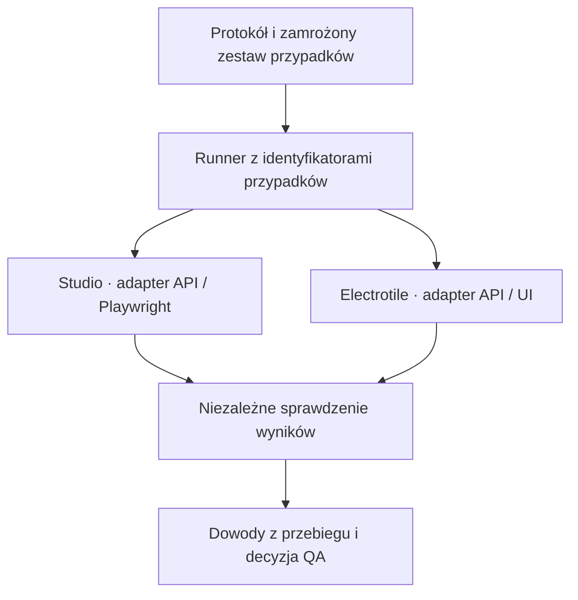

# ET/2025/7 — architektura i plan wdrożenia testów

Plan wykonawczy do [protokołu odbiorczego](ELECTROTILE-ACCEPTANCE.md) i [instrukcji laboratorium testowego](ELECTROTILE-TEST-LAB.md). Załącznik 2, §E, s. 10–13 obejmuje testowanie funkcjonalne i niefunkcjonalne oraz poprawki w trzech modułach. Zapytanie przewiduje 14 dni od podpisania umowy. Próbka uruchamialna z oferty służy do oceny metody pracy. Odbiór wymaga wykonania na systemie i danych uzgodnionych z Electrotile.

## Zakres postępowania i produkt

ET/2025/7 dotyczy usługi testowania oraz naprawy usterek w modułach I–III. Części A–D załącznika nr 2 opisują cele i kontekst całego projektu. Pozycje z tabeli D, w tym deklarowana dokładność 20 cm i wypełnienie stołu laminacyjnego, mają inny status niż cztery próby brzegowe powtórzone w §E. Dla ścieżek objętych §E sprawdzamy wymagany wynik oraz integrację modułów. Wykonanie modułu materiałowego i konfiguratora opisują osobne ogłoszenia 297362 i 297363. Zapytanie ET/2025/7 wymaga złożenia jednej kompletnej oferty do 7 grudnia 2026 r. Kryterium punktowym jest cena netto (100%). Scenariusze pokryć dachowych, opis techniczny i lokalnie uruchamialna próbka należą do dokumentów udziału. [Ogłoszenie 297365](https://bazakonkurencyjnosci.funduszeeuropejskie.gov.pl/ogloszenia/297365) · [Moduł materiałowy](https://bazakonkurencyjnosci.funduszeeuropejskie.gov.pl/ogloszenia/297362) · [Konfigurator](https://bazakonkurencyjnosci.funduszeeuropejskie.gov.pl/ogloszenia/297363)

| Wniosek z produktu | Konsekwencja dla testów |
|---|---|
| eTile Classic ma pełną wersję aktywną z ośmioma mikropanelami, wersje połówkowe z czterema mikropanelami po określonej stronie i element bierny. Wymiary nominalne opisanych wersji aktywnych to 1191 × 840 mm, a efektywne 1157 × 820 mm. | Licz osobno arkusze pokrycia, aktywne jednostki handlowe, mikropanele i moc. Identyczny zewnętrzny obrys i ta sama moc nie potwierdzają poprawnego doboru prawego lub lewego wariantu. Sprawdź stronę i dopuszczalny zakres cięcia z zatwierdzonego katalogu. [eTile Classic](https://www.electrotile.com/pl/dachy-solarne/blachodachowka-solarna-etile-classic) |
| eTile Flat ma blachę na rąbek click. Fusion mocuje moduły do zamków lub rąbków z uchwytami eShark. Step ma płaski modułowy zamek click/slide. | Rozdziel rodziny w danych odniesienia. Potwierdź kompatybilność profilu, wymiary efektywne, reguły wariantów i współczynnik mocy dla koloru na podstawie zatwierdzonej karty. Nie przeliczaj publicznej wartości Wp/m² jak znamionowych Wp na sztukę. [Flat](https://www.electrotile.com/pl/dachy-solarne/blacha-fotowoltaiczna-na-rabek-etile-flat) · [Fusion](https://www.electrotile.com/pl/dachy-solarne/system-fotowoltaiczny-na-rabek-etile-fusion) · [Step](https://www.electrotile.com/pl/dachy-solarne/dachowka-fotowoltaiczna-etile-step) |
| Specyfikacja wymaga również systemu fasadowego. | Uzyskaj od klienta listę przewidzianych systemów fasadowych, wymiarów, schematów i reguł. Karty dachówek służą do przygotowania scenariuszy dachowych. |

## 1. Ryzyka, kryteria i mierzone zdarzenia

| ID protokołu | Wynik i pomiar | Najważniejsza kontrola poprawności |
|---|---|---|
| I-01 · satelita → 3D | 10 adresów wylosowanych z uzgodnionej populacji w jednym województwie. Każdy pomiar od uruchomienia przez użytkownika interfejsu do poprawnego zapisu i otwarcia eksportu w niezależnym czytniku. Cel 300 s, granica 900 s. | W rekonstrukcji jedynym źródłem geometrii jest zdjęcie satelitarne danego adresu. Pomiar referencyjny służy wyłącznie do oceny. Sprawdź właściwy budynek, powierzchnie, krawędzie, skalę i spadek połaci oddzielnie. Zamroź tolerancje przed losowaniem. |
| I-02 · dobór PV | Odtworzenie udostępnionych oszacowań profesjonalnych (ok. 100). Zdarzenia od przyjęcia kompletu danych do kompletnego doboru liczby i typu PV. Cel 60 s, granica 120 s, odchylenie ilości ≤ 20%. | Porównanie liczby i typu/SKU według zatwierdzonych równoważności. Przed uruchomieniem ustal jednostkę porównania z historycznych wycen, w tym sposób traktowania arkuszy połówkowych i biernych, regułę agregacji i dane odniesienia. Przy referencji zero wynik ilościowy wynosi zero. Pokaż też różnice per przypadek i per SKU. |
| I-03 · geometria, moc i uzysk | Znane przypadki analityczne i eksport z niezależnego modelu dla tego samego pliku pogodowego, lokalizacji, strefy czasowej, geometrii, strat i konfiguracji optymalizatora. Porównanie STC, kWh/rok i profili okresowych. | Ujawnij błędy skali, orientacji, nakładania, otworów, konwersji jednostek i maskowania cienia. Przelicz przy tej samej pogodzie scenę bez zacienienia oraz ze zmianą nachylenia. Tolerancje energetyczne wymagają uzgodnienia. |
| II-01 · wzory, BOM i cięcia | Porównanie z zatwierdzonymi listami dla dachu i fasady oraz regułami producenta. Oddziel pomiar czasu obliczeń od poprawności. | Niezależny bilans wsadu, odcinków, rzazu i odpadu na profilu. Sprawdź kod, sztuki, długości, kąty, minimalne odcinki i rozróżnienie elementów czynnych oraz biernych. Niewykonalny układ musi mieć uzasadnienie. |
| II-02 · elektryka i wiązki | Porównanie listy połączeń i fizycznej trasy z dokumentacją oraz pomiarem referencyjnym. | Kontrola portów, typu złącza, polaryzacji, długości po trasie, zapasu oraz ograniczeń urządzeń. Przypadki graniczne i ocena projektanta według zatwierdzonego katalogu. |
| N-01 · partia adresów | Od pierwszego zgłoszenia do gotowości ostatniego z 20 poprawnie wstępnie obrobionych zdjęć satelitarnych. Cel 300 s, granica 500 s. W osobnych przebiegach zimny i rozgrzany cache. | Wynik musi należeć do właściwego adresu i być gotowy do pobrania. Brak lub duplikat pod innym ID nie domyka partii. Odnotuj oczekiwanie, dostawcę, przetwarzanie oraz ponowienia. |
| III-01 · konfigurator | Media → wersja oferty → zamówienie → pomiar/audyt. Próby równoległe na tej samej ofercie i rezerwacji. | Publikacja wiąże ofertę z konkretną rewizją, zamówienie ze wskazaną ofertą, a ponowienie tego samego żądania z jednym skutkiem. Dwóch klientów nie otrzymuje tego samego terminu. |
| III-02 · kompletna oferta | Od kompletnego zgłoszenia do gotowej wizualizacji, kosztorysu i kalkulacji opłacalności. Granica 6 h czasu zegarowego, włącznie z oczekiwaniem oraz czynnościami człowieka. | Sprawdź komplet dokumentów, wersję danych, cennik, założenia i reprodukowalność opłacalności. Raportuj czasy aktywne i oczekiwania oraz oddzielnie czas zgłoszeń wymagających uzupełnienia. |

W raportach czasowych pokaż liczbę prób, maksima, rozkład i liczbę przekroczonych celów. Dla małych prób publikuj wszystkie wyniki per przypadek. Wyniku po restarcie lub ponowieniu nie wyjmuj z pierwotnego czasu. Przekroczenie celu z dotrzymaniem granicy i poprawnym wynikiem pozostaje zaliczeniem z odchyleniem. Przekroczenie granicy, utrata poprawnie zgłoszonej próby lub wadliwy rezultat oznacza FAIL.

## 2. Konstrukcja systemu testowego

- **Testowane wejścia.** Laboratorium uruchamia przypadki lokalnie i pobiera rzeczywiste wyniki z API, interfejsu lub eksportu za pomocą adaptera. Adapter Electrotile powstaje po inwentaryzacji interfejsów i uzgodnieniu sposobu odczytu stanu końcowego. Otrzymuje wejście przypadku, a niezależna kontrola porównuje jego wynik z zamrożonym wzorcem. Testy i dane referencyjne są wersjonowane niezależnie od silnika.
- **Tryby uruchomienia.** `studio-fixture` działa na wersjonowanych danych syntetycznych w CI. `replay` odtwarza utrwalone odpowiedzi usług i błędy według scenariusza. `client-live` mierzy uzgodnione środowisko odbiorcze z rzeczywistymi ścieżkami pozyskania danych. Raport identyfikuje tryb na poziomie każdego wyniku i całego przebiegu. Kryteria odbioru Electrotile otrzymują PASS wyłącznie z kompletnego przebiegu odbiorczego. Rejestr źródeł oznacza satelitę, ortofoto oraz LiDAR odrębnymi wartościami.
- **Zestawy danych.** Krótki zestaw deterministyczny przy każdym PR, większy zestaw regresyjny przed wydaniem, zamrożona próba odbiorcza. Populacja adresów i zawodowe wyceny mają wersję, identyfikatory i spis wyłączeń uzgodniony przed losowaniem. Utrwal seed i algorytm losowania; oddziel całe budynki i ich warianty między strojeniem a próbą odbiorczą. Zachowaj niepowodzenia i braki w raporcie. Korektę złego wejścia udokumentuj i ponów według uzgodnionej reguły.
- **Porównanie i tolerancje.** Analiza z ręcznie policzonymi figurami i niezależnym odczytem eksportu jest pierwszą linią. Porównania z drugim algorytmem na tych samych wejściach wykrywają rozbieżności i podlegają ocenie projektanta. Osobno ewidencjonuj tolerancję numeryczną, rozdzielczość obrazu i uzgodniony błąd użytkowy. Nie przenoś tolerancji jednej klasy pomiaru na inną.
- **Dowód i reprodukcja.** Rekord przebiegu zawiera `run_id`, tryb, SHA testów i testowanego wydania, środowisko/region, limity zasobów, wersje narzędzi, katalogu, danych i referencji. Rekord przypadku dodaje `requirement_id`, `case_id`, wersjonowane ID wejścia i SHA-256, seed, tryb cache, zdarzenia START/END, czas monotoniczny, oczekiwany wynik, wynik rzeczywisty, status, wersję reguły i odnośniki do artefaktów z ich skrótami. Dla prób rozproszonych czas licz tym samym zegarem obserwatora na obu końcach. Raportuj czynności człowieka i asynchronicznych usług z jednym ID korelacji i zsynchronizowanymi znacznikami UTC.
- **Przechowywanie.** GitHub przechowuje procedury, dane syntetyczne i ich wyniki. Materiały klienta, logi z danymi osobowymi i licencjonowane zdjęcia pozostają w uzgodnionej przestrzeni z kontrolą dostępu i retencji. Publiczne artefakty wskazują na nie tylko losowym identyfikatorem. Statusy to PASS, FAIL, BLOCKED (brak warunku wejściowego) i NOT_RUN (zaplanowano, brak wykonania).

## 3. Metody ponad standardowe scenariusze

| Obszar | Testy o największej wartości | Przejście bramki |
|---|---|---|
| Geometria i eksport | Własności: przesunięcie, obrót, alternatywne odwzorowanie układu osi, granice spasowania, otwór, komin i połać pionowa. Niezależne porównanie pełnych obrysów i modelu w czytniku OBJ z metryczną sceną i modułami wskazanego wariantu. | Opublikuj seed i błędy z reprodukcją. Testy muszą wykryć celowe zmiany wyniku, m.in. przejście przez otwór, pominięty moduł, odwróconą oś lub źle osadzony OBJ. |
| Energia i materiały | Własności fizyczne, ręczne przykłady, porównanie obliczeń z niezależnym narzędziem i dokumentacją. Celowe defekty: W/kW, znak azymutu, pominięcie rzazu, błędna pozycja SKU, przerwany obwód. | Uzgodniony błąd odtwarzany per profil, obwód i połać. Wynik i rozbieżności można prześledzić do wersji źródła. |
| Kolejka, zapis i oferta | Sterowany zegar i synchronizacja równoczesnego zapisu. Wstrzyknięte przejściowe błędy dostawcy, timeout, podwójna dostawa, śmierć workera między zapisem a potwierdzeniem, błędna odpowiedź i utrata dzierżawy. | Brak podwójnego zamówienia lub publikacji, brak nadpisania nowszej rewizji przez wynik starego zadania, kompletne i policzalne stany końcowe. Oddzielnie próba żywej partii 20. |
| Środowisko i wydajność | Zimny i rozgrzany przebieg, realistyczne napływanie adresów, duże poprawne wejście i profil pamięci/CPU. Izolowane konta i dane testowe. | CI wykonuje bramkę kontenera przy 250 MB i 0,1 vCPU. Osobno benchmark klienta na zamrożonej wersji sprzętu, dostawców i limitów. Pokaż p50/p95 oraz maksimum i nie zatajaj timeoutów. |

## 4. Kolejność wdrożenia

| Etap | Praca i warunek zamknięcia |
|---|---|
| A · gotowość przed startem | Wykonaj próbkę lokalnie na dostępnym API Studio i potwierdź czułość kontroli na celowo błędnych odpowiedziach. Zachowaj pierwszy wynik, wartości oczekiwane i rzeczywiste oraz retest tych samych przypadków. |
| A · geometria i moc STC | Uruchom niezależny odczyt OBJ i porównanie z zatwierdzoną geometrią oraz mocą modułów. Zweryfikuj czułość kontroli na dachu i fasadzie przez celową zmianę eksportu lub danych układu, a następnie wykonaj retest. Próby lokalne zakończone. |
| A · ciągłość danych produktowych | Uruchom przypadki Classic z rozróżnieniem arkusza, mikropanelu, wymiaru krycia i strony aktywnej. Porównaj układ, materiały, schemat i ofertę według tej samej rewizji. Próby kontrolne i retest zostały wykonane na symulowanych odpowiedziach. |
| A · kolejne prace własne | Przygotuj porównanie rocznego uzysku na identycznym pliku pogody i konfiguracji oraz obserwację zdarzeń do pomiaru pełnej partii i oferty. |
| B · dni 1–2 od startu z klientem | Inwentaryzacja wersji trzech modułów i pierwszy pomiar bazowy. Potwierdzenie danych satelitarnych i licencji, listy adresów, historycznych wycen, katalogu, pomiarów i ścieżki wprowadzania poprawek. Uzgodnienie jednostki doboru PV, kryteriów jakości, zdarzeń start/stop i reguły braków. Pierwsza próba importu i odczytu eksportu każdego modułu. |
| C · dni 3–7 | Funkcjonalne i graniczne testy I–III oraz testy awarii i współbieżności. Najpierw ścieżki grożące przerwaniem projektu oraz błędnym materiałem, geometrią lub ofertą. Każdy błąd ma wejście, wynik oczekiwany i rzeczywisty, priorytet oraz test regresyjny. |
| D · dni 8–11 | Naprawy, retesty na pierwotnych i sąsiednich przypadkach, pełne pomiary 10 adresów, wycen, kolejki 20 i oferty 6 h. Powtórzenie z przypiętym kodem, danymi i limitami, wraz z odchyleniami i nieudanymi próbami. |
| E · dni 12–14 | Zamrożenie wersji, pełna regresja, niezależne powtórzenie kluczowych wyników, raport śledzenia od wymagania do przebiegu, naprawy i retestu. Zamknięcie odbioru na konkretnym SHA albo opis nierozstrzygniętych kryteriów i przyczyn blokady. |

## 5. Stan wykonania

Instrukcja laboratorium zawiera 18 procedur. Na API Studio zgodnie ze wzorcami przeszły trzy przypadki doboru PV oraz dwie próby geometrii i mocy STC. Sześć celowych zmian w kopiach wyników geometrycznych zostało wykrytych. Retest na ponownie pobranych wynikach zamknął wszystkie wskazane rozbieżności. Próba materiałów i konfiguratora wykazała dziewięć wprowadzonych rozbieżności oraz potwierdziła ich usunięcie w retescie. Dwa przypadki inspirowane eTile Classic wykazały 14 rozbieżności w kontrolowanych odpowiedziach. Retest zaliczył oba przypadki. Kryteria czasowe mają osobny protokół oceny.

Prace B–E wymagają środowiska testowego Electrotile, dostępu do interfejsów i eksportów, danych referencyjnych oraz odpowiednich licencji. Wyniki odbiorcze oczekują na przebieg na wersji klienta i decyzję QA.
