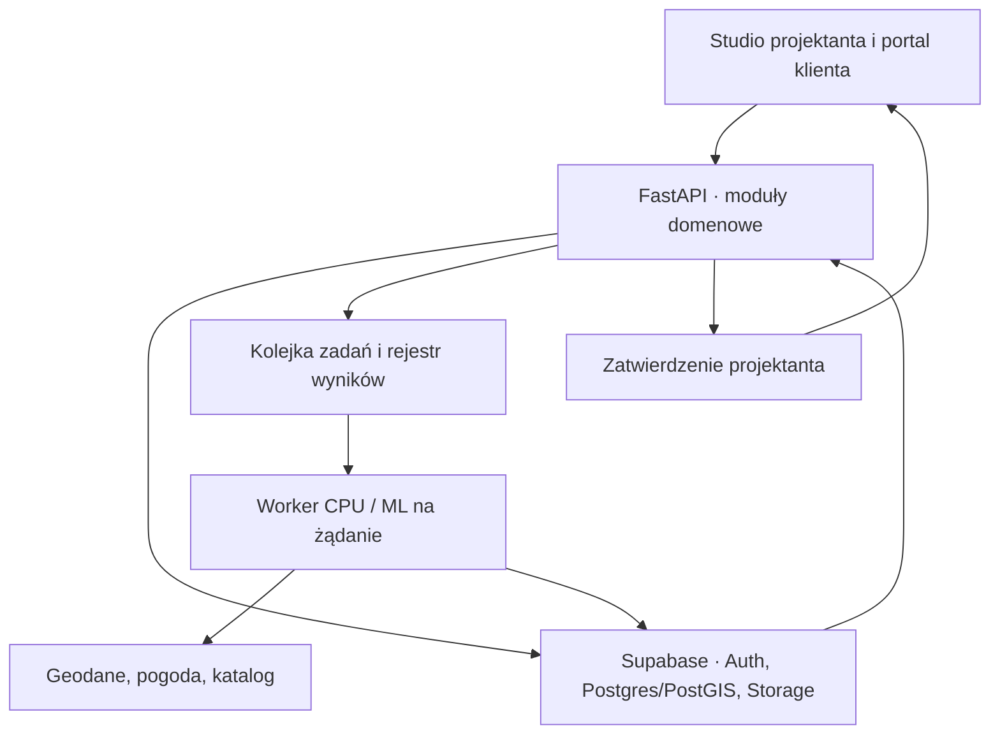

# BIPV Studio — plan budowy produktu

Status: proponowany plan wykonawczy, 20 listopada 2026. Obowiązuje od istniejącego wdrożenia. [Aktualny stan planu](IMPLEMENTATION-STATUS.md). [Stan ostatniego release'u](RELEASE.md) · [Kontrakty działającego kodu](HANDOFF.md) · [Macierz Electrotile](ELECTROTILE-DELIVERY.md) · [Backlog Foundry](../foundry/PRODUCT-BACKLOG.tsv) · [Runbook agentów](../foundry/PRODUCT-EXECUTION.md).

## Produkt, który wypuszczamy

Pierwszym użytkownikiem jest projektant lub instalator jednego systemu BIPV. Przyjmuje zgłoszenie z adresem, zdjęciami i rzutem, wybiera budynek na mapie, koryguje obrys i potwierdza skalę oraz geometrię dachu lub fasady. Porównuje dwa wykonalne warianty. Widzi roczny uzysk z założeniami, koszt, listę SKU i cięć oraz wyniki kontroli elektryki. Po sprawdzeniu publikuje wersjonowaną ofertę. Klient może obejrzeć lekki model 3D i zgłosić zamówienie z tej oferty oraz zarezerwować pomiar. Instalator widzi, jaką konfigurację i wersję oferty klient wybrał. Wyniki pomiaru prowadzą do nowej rewizji, którą można porównać z ofertą.

Pierwsza wersja komercyjna to zamknięty pilotaż jednej firmy, jednego zweryfikowanego systemu montażowego i dwóch klas instalacji: dach oraz płaska fasada. Model danych obsługuje wiele organizacji i producentów od początku. Drugi katalog, nietypowe systemy fasadowe i produkcyjne planowanie laminatora przechodzą własne testy przed włączeniem. Publiczne pakiety z danymi syntetycznymi służą do testów i nauki. Katalog produkcyjny wymaga rzeczywistych SKU, instrukcji pokrycia, połączeń, cen i zgody na użycie danych.

Podstawa już jest: FastAPI, React/Three.js, Shapely, Supabase, Railway, metryczne płaszczyzny z otworami, warianty siatki, zapis rewizji, OBJ i regresja w CI. Zachowujemy te ścieżki. Aktualny limit sceny 6 powierzchni/250 m² traktujemy jako limit wdrożonej wersji. Podnosimy go po pomiarach liczby kandydatów i pamięci, a nie przez samo zwiększenie stałej.

### Konkurencja jako źródło wymagań

| Grupa z rejestru 58 produktów | Przykłady | Decyzja w Studio |
|---|---|---|
| Geometria z adresu i pomiar | Aurora AI Roof, Google Solar, Scanifly, EagleView, HOVER, Nearmap | Asynchroniczne przygotowanie danych, ręczna korekta na obrazie, źródło i pewność per powierzchnia. Komercyjny adapter dopiero po próbie na polskich adresach i sprawdzeniu praw do obróbki oraz retencji. |
| BIPV i konfiguratory producentów | BIMsolar, 3S Designer, Solar.Pro.Tool, BIPVPlaner, Virto.CORE | Dach i fasada na wspólnym modelu. Własny katalog reguł obejmujący wymiary krycia, elementy bierne, profile i wiązki. Każda pozycja ma odniesienie do reguły i danych. |
| Projekt PV, energia, elektryka | PVsyst, PV*SOL, SAM/PySAM, HelioScope, SolarEdge, PVcase | Oddzielny benchmark na tych samych wejściach. W produkcie jawne straty, poprawny podział AC/DC i weryfikowalne ograniczenia. PVGIS/pvlib jako wejścia i implementacja domenowa. |
| Kosztorys, dach i sprzedaż | Roofr, RS Dachy, Ruukki, OpenSolar, EasySolar, Solar Monkey | Przedmiar z geometrii oraz stan oferty i audytu w jednym projekcie. Wersja cennika, zakres kosztów, założenia opłacalności i odbiór po pomiarze. |
| Alternatywy regionalne i infrastruktura | LONGi, Huawei, Sungrow, Tangent, Solar Pro, Solargis, Meteonorm, Solcast | Rejestr źródeł i interfejs adaptera zamiast zależności od jednego ekosystemu. Warianty porównywane na wspólnym zestawie przypadków. |

Rejestr 58 pozycji, 46 komponentów, 57 wymagań oraz 92 zapytań w 8 językach pozostaje źródłem szerokiej mapy rynku. Tu wybrano decyzje, które zmieniają produkt. Dane pochodzą z dokumentacji i deklaracji dostawców. Pokrycie, jakość, ceny i czasy dla polskich projektów rozstrzygają dopiero własne porównania. Źródła pierwotne: [Aurora AI Roof](https://docs.aurorasolar.com/reference/ai-roof), [BIMsolar](https://www.bim-solar.com/faq), [Virto.CORE](https://virto.solar/en/products/virto-core/), [Google Solar Data Layers](https://developers.google.com/maps/documentation/solar/data-layers).

Przewaga produktu do sprawdzenia w pilotażu: ile czasu projektanta znika dzięki temu, że zmiana połaci lub SKU prowadzi jednym przebiegiem do nowych modułów, materiałów, energii i oferty. Mierzymy czas czynny, liczbę ręcznych korekt i przyczyny rozbieżności z pracą instalatora. Konkurencja wyznacza funkcje i ergonomię, a realne pomiary rozstrzygną przewagę.

## Architektura

**Frontend.** React, TypeScript, Vite, Three.js/R3F, MapLibre, TanStack Query i lokalna historia komend. Jeden projekt i wspólna selekcja między mapą, widokiem UV i 3D. Warstwy mapy i WebGL ładowane wtedy, gdy użytkownik wchodzi w dany tryb. Worker przeglądarkowy może obsługiwać obróbkę widoku i podgląd, a zapis i wyniki wydawane klientowi przechodzą autorytatywną walidację backendu. Wejścia 3D mają własne kontrakty. GLB zasila lekki podgląd, OBJ zostaje dla interoperacyjności, DXF dochodzi przy sprawdzonych regułach jednostek i warstw.

**Układ interfejsu.** Lewa kolumna pokazuje projekt, źródła, połacie i przeszkody. Środek przełącza mapę, rzut i 3D bez utraty wyboru. Prawy panel pokazuje specyfikację obiektu, jakość danych i blokady. Dolny pasek porównuje warianty według mocy, kWh/rok, materiałów i ceny. Kliknięcie pozycji BOM podświetla konkretne moduły lub odcinki. Widok klienta zawiera wariant, 3D, zakres ceny, założenia, aktualność i rezerwację. Tryb porównania nakłada dwie rewizje i pokazuje różnice. UX zaczyna od przebudowy kluczowych interakcji na istniejącej scenie, potem przechodzi test z instalatorem. [Projekt interfejsu](PRODUCT-UX.md). Proponowane cele: płynna nawigacja na laptopie referencyjnym, P95 reakcji na wybór <150 ms, warstwa dostępności dla wszystkich akcji poza samym oglądaniem 3D, spójne stany błędu i ładowania.

**Backend.** Jeden modularny monolit FastAPI/Pydantic. Moduły: projects, intake, geo, geometry, catalog, layout, electrical, energy, materials, offers, audits, jobs. Granice w kodzie, modele i przykładowe JSON w repo, OpenAPI generowane i sprawdzane w CI. Python 3.12 i uv, Node zgodny z istniejącym lockfile, SQL migrations w GitHub. Rozdzielamy artefakty buildów API, worker CPU i środowisko eksperymentów. Biblioteki PyTorch/GDAL/OR-Tools wchodzą do właściwego obrazu tylko po teście pamięci oraz zimnego startu. Pierwsze wydanie mieści lekkie API w istniejącej usłudze Railway.

**Dane.** Postgres przechowuje dane domenowe i stan jobów, PostGIS metadane geograficzne i wyszukiwanie przestrzenne. Storage prywatne dla plików klienta oraz artefaktów z sumą SHA-256, wersją i retencją. Supabase Auth dla użytkowników, tabele członkostwa, RLS na rekordach i obiektach, dostęp roli tenantowej przez API. Zaproszenia, anulowanie i odejście z organizacji skutkują utratą dostępu. Historyczny projekt gościa przechodzi jawne, jednorazowe przejęcie po sprawdzeniu obu uprawnień w transakcji. Nie stosujemy klucza administracyjnego w przeglądarce ani modelu. Link klienta ma ograniczony zakres, termin i możliwość cofnięcia. Media trafiają do stanu oczekującego na walidację typu, rozmiaru i rzeczywistego formatu.

| Encja | Niezmiennik |
|---|---|
| Organization / Member / Project / Intake | Każdy rekord biznesowy i obiekt Storage należy do konkretnego tenanta i projektu. Dane kontaktowe i zdjęcia są oddzielone od danych wyszukiwanych przez modele. |
| SourceAsset / SceneRevision | Pochodzenie, licencja, dozwolony okres użycia, data, CRS i układ wysokości. Poligony w lokalnym ENU/UV, adapter Scene v1, stabilne ID. Wynik pomiaru i wynik inferencji mają odrębne statusy. |
| CatalogVersion / ProductVersion / PatternVersion / RuleSet / PriceBook | Identyfikatory i wersje unieruchomione w użytych projektach. Katalog zawiera wymiary zewnętrzne i krycia, reguły montażowe, Wp, elektrykę i dokument źródłowy. Brak reguły blokuje zależne wyjście. |
| LayoutRun / EnergyRun / BOM / ElectricalRun | Każdy wynik odnosi się do zatwierdzonego wejścia i hasha konfiguracji, wersji silnika, katalogu i źródła pogody. Porównanie opiera się na tych samych założeniach. |
| OfferVersion / OrderRequest / AuditBooking | Oferta wskazuje konkretną rewizję projektu, wyniki, walutę, cennik i ważność. Archiwalna oferta zachowuje własny snapshot także po przekroczeniu limitu zwykłej historii. Zgłoszenie zamówienia wskazuje ważną ofertę, wybrane pozycje i stan potwierdzenia. Rezerwacja jest transakcyjna i idempotentna. |
| Job / Artifact / ToolRun / AuditEvent | Stan wykonania, próba, koszt, artefakt, kto zatwierdził i które dane widział. Telemetria pomija treść zdjęć, sekrety i adresy. |

**Operacje.** Lekki layout można liczyć synchronicznie do określonego budżetu kandydatów. Rekonstrukcja, solver rozszerzony, energia, raport i partia adresów zwracają 202 i job ID. Postgres/Supabase Queues jako trwała kolejka. Stan joba w tabeli, lease, visibility timeout, retry z backoff, limit prób i kwarantanna. Skutki uboczne są idempotentne nawet po redelivery. Zapis wyniku unikalny po tenancie, typie, hashu wejścia i wersji silnika; ten sam wynik nie zmienia bieżącej rewizji po późniejszej edycji. Realtime opcjonalnie sygnalizuje zmianę, po reconnect klient odczytuje stan. Worker na żądanie, bez permanentnego pollingu w usypianym serwisie. Na etapie 40 promptów ciężki worker może działać na zatwierdzonym runnerze lokalnym/Foundry z wąskim dostępem do konkretnego joba; pierwsza usługa Railway zachowuje obecną konfigurację. Pomiar determinuje osobną produkcyjną instancję, budżet i retry. CI służy do fixture i benchmarków, bez publicznego triggera do zadań klientów.

## GIS, geometria, energia i materiały

1. **Lokalizacja i pomiar.** Użytkownik potwierdza punkt i konkretny budynek. Adapter pozyskuje dozwolone źródło. Skala z georeferencji lub punktów kontrolnych. Fasada ze zdjęcia wymaga kalibracji płaszczyzny, danych kamery lub poprawnie rozmieszczonych punktów i wymiaru. Dla polskiego toru operacyjnego można prototypować z GUGiK ortofoto i wysokościami, gdy metadane i prawa pozwalają. Tor zdjęcia satelitarnego używa właściwie licencjonowanego zdjęcia i osobnego protokołu. Przy nieznanym spadku/wysokości produkt pokazuje hipotezę i prosi o korektę. Jedno niskorozdzielcze zdjęcie 2D nie wyznacza jednoznacznie 3D. [Geoportal ORTO](https://www.geoportal.gov.pl/pl/dane/ortofotomapa-orto/).
2. **CV i ML.** Baseline CPU: kadrowanie georeferencjonowane, OpenCV krawędzie i segmentacja, szkic edytowalny, dopasowanie prostych i przecięć. Ranking kandydatów połaci i sugerowane grzbiety to osobne wyniki, które operator może przyjąć lub poprawić. Osobny eksperyment z SAM 2.1 jako model proponujący maskę po punkcie/ramce operatora. System rozróżnia kontur, grzbiety, otwory i przeszkody. Przy jawnej przewadze na held-out stosujemy lekki model ONNX Runtime CPU lub grafikę na żądanie. Wagi i licencja przypięte skrótem. MLflow lokalnie lub manifesty eksperymentów i metryki w artefaktach Actions, bez stale utrzymywanego serwera. Zestaw oceny zamrożony przed strojeniem, podział wg budynku/geografii/źródła, zapis czasu edycji, pokrycia, IoU i błędu granicy w metrach. Wagi w Storage tylko jeśli regulamin i miejsce pozwalają. [SAM 2](https://github.com/facebookresearch/sam2) · [ONNX Runtime](https://onnxruntime.ai/docs/).
3. **Layout i dobór.** Shapely/GEOS i pyproj, określona tolerancja oraz niezależny walidator pełnego obrysu modułu. Katalog liczy rozstaw wg wymiaru krycia, zakładu, obrotu, marginesów i krawędzi. Klasy: aktywny, bierny, element cięty, zakaz cięcia. Baseline siatkowy dostarcza szybko wykonalny układ. OR-Tools CP-SAT wybiera w ramach zbudowanych kandydatów. Rozwiązania zwracają status, czas, wartość, best bound jeśli dostępny, i powód odrzucenia. Rekomendacja oparta na regułach ekspertów działa przed ML. Ranking LightGBM rozważyć po udowodnieniu przewagi na zamrożonych wycenach. Optymalizacja rozdziela kryteria kWh, koszt i odpad, bez cichego mieszania jednostek. [OR-Tools](https://github.com/google/or-tools).
4. **Elektryka i uzysk.** Graf połączeń z napięciami przy temperaturach granicznych, Vmp/Voc, limitami MPPT i prądu, przewodami po dozwolonych trasach. Kompetentny projektant zatwierdza reguły i zdjęcie blokady. pvlib z zamrożonym źródłem pogody liczy pozycję Słońca, POA i temperaturę BIPV, DC i AC. Cień bezpośredni pochodzi z wiązki promieni i próbkowania po panelu, z osobnym ujęciem rozproszenia. Bilans strat odróżnia zacienienie, temperaturę, mismatch i falownik. Optymalizatory po parametrach urządzeń. Porównanie z PVsyst/PySAM na tych samych warunkach. [pvlib](https://pvlib-python.readthedocs.io/en/stable/) · [PVGIS API](https://joint-research-centre.ec.europa.eu/photovoltaic-geographical-information-system-pvgis/getting-started-pvgis/api-non-interactive-service_en).
5. **Wzór wewnętrzny mikropanelu.** Katalog obejmuje zatwierdzone szablony z wersją, topologią wewnętrznych obwodów, granicami dozwolonych parametrów i przypisaniem do rodziny produktu. Projektant wybiera i dostosowuje wzór wewnątrz granic producenta. Zmiana wzoru tworzy konfigurację używaną do liczenia BOM i elektryki. Edycja wzoru wewnętrznego i rozmieszczanie gotowych wyrobów na połaci mają odrębne układy współrzędnych i reguły.
6. **Materiały i wydanie.** BOM ma SKU, jednostkę, źródło reguły, połać, ilość i straty. Profile jako zadanie 1D cutting stock z długością sztangi, rzazem, odpadami, kątami i naddatkami. Wiązka jest sumą odcinków trasy z zapasem i typami złączy. PDF/CSV/GLB i zestawienie porównawcze powstają z jednego snapshotu. Kalkulacja ceny serwerowa, jawne założenia finansowe, audyt z blokadą dwukrotnego przydziału terminu oraz ewidencją zmiany. Wycenę z brakującymi danymi można zapisać jako roboczą. Gotowa oferta wymaga zatwierdzenia.

## AI w produkcie

Trzy role z ograniczonym kontraktem, uruchamiane według etapu. **Geometria** proponuje kontur i listę brakujących pomiarów. **Porównanie** uruchamia dozwolone zadania wariantowe i wyjaśnia wynik na podstawie liczb ze zweryfikowanego API. **Asystent oferty** przygotowuje opis, wskazuje sekcje źródłowe i sugeruje pytania do audytu. Model otrzymuje skrojony kontekst projektu. Przebiegi z domyślnie ograniczoną liczbą wywołań i rejestrem kosztu. Dostęp do produkcji przez zweryfikowane narzędzia z przypisanym tenant, nie przez ogólną konsolę SQL. Zmiany proponowane jako draft/diff z expected_revision, zatwierdzane w UI. Kosztowna symulacja, wystawienie oferty, wysyłka albo rezerwacja korzystają z normalnej domenowej akcji i uprawnień. Liczby w raporcie pobierane z wersjonowanych wyników, brak danych ma jawny status.

Na początek kodowy graf stanów w Pythonie z adapterem modelu i testowym providerem. Włączenie realnego Foundry po weryfikacji projektu, stawek i limitu. LangGraph lub Microsoft Agent Framework mają sens, gdy prosty workflow nie pokrywa rzeczywistych wymagań. Microsoft kończy wsparcie edytora wizualnego i wykonywania deklaratywnych workflow w portalu 1 grudnia 2026, a do nowych przepływów rekomenduje Agent Framework. Rozdzielamy agentów do budowy produktu od tych, którzy działają w aplikacji. [Dokumentacja Foundry](https://learn.microsoft.com/en-us/azure/foundry/agents/concepts/workflow).

## Roadmapa i decyzje o wydaniu

| Tydzień | Dostarczony przebieg | Bramka i zależność |
|---|---|---|
| 1 · kontrakty, dostęp, warsztat UI | Tenant, role i Storage, współdzielony Scene/Catalog/Job kontrakt, warsztat 2D/3D z pomiarem, przygotowane przypadki, integracja CI. | Izolacja dwóch organizacji, migracja gościa, round trip starej sceny i wersji. Dane producenta oraz wycen zamrożone albo status BLOCKED. |
| 2 · adres → szkic | Lokalizacja, georeferencjonowany obraz, korekta obrysu, skala/połać, 3D, eksport i pierwsza propozycja CV. | Eksport z mierzalną skalą i źródłem. Test utraty pokrycia, źródła o różnej dacie, fasady i zmiany rewizji. Rozdzielone replay i live. |
| 3 · wykonalny projekt i przedmiar | Wersja katalogu, aktywne i pasywne elementy, dopuszczalne pozycje, układ, reguły profili, trasy, elektryczne blokady. | Dwa warianty na zamrożonym projekcie z realnymi kartami. Brak kolizji, wszystkie pozycje BOM wyjaśnialne. Ekspert porównuje projekt na danych producenta. |
| 4 · energia, oferta i audyt | Pierwszy wynik kWh/rok z założeniami, kalkulator kosztu, PDF i link klienta, rezerwacja, przejście E2E w CI. | Realny projekt dachowy i fasadowy lub jawnie zablokowana domena. Dwóch instalatorów przechodzi proces i spisuje rozbieżności. Wystawienie oferty wymaga akceptacji projektanta. |
| 5–6 · stabilizacja pilotażu | Benchmark 10/20, walidacja porównawcza, obniżenie kosztu, asystent wariantów, panel operacyjny i przywrócenie backupu. | Wszystkie obowiązkowe testy w zakresie pilotażu, poprawione blokery, restore na izolowanym środowisku. Decyzja o otwarciu na więcej klientów po danych. |

Czas jest planem roboczym dla kilku równoległych agentów, z ręczną weryfikacją i dostępnością danych. **40 promptów** to 32 pakiety budowy i 8 kontroli w backlogu. **60** dodaje 20 pakietów niezawodności, audytu i rzeczywistej automatyzacji. **100** obejmuje jeszcze 40 wywołań na poprawki, niezależną ewaluację i prace nad danymi. Gdy brakuje danych licencyjnych, instrukcji producenta albo eksperta, zamykamy wykonanie techniczne na fixture i utrzymujemy status otwartej bramki produkcyjnej. Każdy artefakt ma status zgodny z wykonanym testem.

| Próba | Cel i warunek |
|---|---|
| Specyfikacja · model 3D | 10 losowanych adresów jednego województwa, tor wyłącznie satelitarny, cel 300 s i maksimum 900 s od uruchomienia interfejsu do używalnego eksportu. Seed, reguły niedostępności, dopuszczalne ingerencje i kryteria geometrii ustalić przed testem. Tor odtwarzany z cache raportować oddzielnie. |
| Specyfikacja · dobór | Cel 60 s i maksimum 120 s. Maks. 20% od ekspertów, z uzgodnieniem miary liczby, mocy, zgodności SKU i przypadków zerowych. Około 100 historycznych wycen według dokumentacji, dostęp do potwierdzenia. |
| Specyfikacja · partia | 20 adresów, obraz obrobiony dla każdego. Cel 300 s i maksimum 500 s od pierwszego zgłoszenia z logiem limitów, kolejki i retry. |
| Specyfikacja · oferta | Cel 6 h. Napisać przed pomiarem, co uznajemy za kompletne zgłoszenie i gotową ofertę. Zmierzyć osobno czekanie i aktywny czas człowieka. |
| Produkt · integracja i zaufanie | Brak naruszeń izolacji, kolizji i podwójnych rezerwacji w przypadkach testowych. Oferta możliwa do ponownego wygenerowania z utrwalonych wejść. Każdy pokazany rezultat ma status, jednostkę i pochodzenie. |
| Produkt · pilotaż | Propozycja: min. 3 pełne projekty, w tym jeden dach i jedna fasada, dwóch operatorów, minimum jeden scenariusz korekty po audycie. Wynik porównany z obecnym procesem, z listą błędów blokujących wystawienie oferty. |

Zakres ET/2025/7 obejmuje testowanie i poprawki modułów zamawiającego. Produkt Registry9 ma osobne repozytorium, katalog, dane, wersjonowanie oraz własny proces sprzedaży. Pakiet testów i adapter SUT nie przenoszą całego IP produktu do oferty. Systemowe wymagania produkcji/laminacji widoczne w specyfikacji stanowią osobną domenę z regułami zakładu, niezależnie od planowania pokrycia i BOM budynku.

## Pokrycie specyfikacji

Identyfikatory odnoszą się do [macierzy 57 pozycji z researchu](https://chatgpt.com/library?file_id=libfile_ec89d380563c8191a749bedae77da3e2&account_id=personal). Zakres w tabeli jest planowany, a dowód zaczyna istnieć wraz z podpięciem wyniku testu.

| Wymagania | Pakiety i dowód |
|---|---|
| I01–I06, ALG01–ALG02 | P09–P14, P16 i P34–P36. Partner obrazu, adres lub GPS, edytowalny obrys, automatyczne propozycje pozycji i płaszczyzny, metryka błędu po korekcie. |
| I07–I10, ALG03–ALG04, SYS02/SYS04 | P12–P13 i P17–P24. Scena i model na podkładzie foto, przeszkody i strefy cienia, wymiary, kalkulacja STC, zgodność katalogu, layout i schemat. |
| I11–I12, ALG05 | P25–P26, P28, P32 i P48. Uzysk według lokalizacji, spadku, kierunku, cienia oraz parametrów zatwierdzonej elektryki, z raportem i przypadkiem wzorcowym. |
| II01–II08 | P17–P24 i P46–P48. Wersje wzorów, dozwolona edycja, cięcia, przedmiar, schemat obwodów, długości wiązek i test porównawczy. |
| III01–III05 | P15 i P27–P32. Dodawanie, zastępowanie i usuwanie załączników, cena, oferta, formularz zamówienia i stan rezerwacji. |
| SYS03, PERF01–PERF04, ACC01 | P01, P23, P32–P36 i P49–P50. Kontrakty API, wyniki na próbach adresowych, porównanie z wycenami i pomiar czasu od zgłoszenia. |
| SYS01, CTX01–CTX04, QA i BID | Laminator i optymalizacja produkcji po uzyskaniu ograniczeń zakładu. QA/BID w osobnym pakiecie ET/2025/7 oraz [planie zamówienia](ELECTROTILE-DELIVERY.md). |

Poza budową trafiają do rejestru wejść trzy pakiety danych: legalne zdjęcia i zaakceptowane zasady retencji, podpisane reguły katalogowe z cenami, wyceny i zweryfikowana geometria z historią odmów. Do każdego przypisujemy właściciela, datę, zakres i licencję. Przed benchmarkiem wybieramy próbę i zachowujemy wszystkie nieudane przypadki.

## Koszt i operacje

| Tryb | Co uruchamiamy | Kontrola kosztu |
|---|---|---|
| Budowa i mały pilotaż | Dotychczasowy Railway Hobby, Supabase Free, lokalny/już dostępny compute do ciężkich zadań, GitHub Actions do kontroli. | $5 to poziom abonamentu i uwzględnionego użycia Railway, z możliwą dopłatą za zużycie. Brak nowej płatnej usługi w planie bazowym. Heavy jobs dopuszczone tylko przy dostępności własnego runnera. Ustalić limity z uwzględnieniem innych aplikacji na tym koncie. Testy na danych dozwolonych do utrwalenia. |
| Aktywny pilotaż | Pomiar wyczerpania limitów, krótkie zadania i tokeny modelu z dostępnej puli. | Przed zmianą planu lub zakupem danych policzyć zużycie i uzyskać decyzję o budżecie. Free może pauzować i ma skończone limity. Krótki program testów, limity per tenant, alarmy i wyłączniki funkcji. |
| Produkt komercyjny | Gwarantowany poziom trwałości danych, test odtworzenia, limit ruchu, plan utrzymania i zatwierdzone SLA danych. | Ustalić budżet przy danych z pilotażu. Koszt/projekt = obrazy + CPU/GPU + LLM (tokeny i narzędzia) + storage/transfer + czas człowieka. Liczymy również nieudane wykonania, ponowienia i utrzymanie kopii. |

Pamięć 45,39 MiB jest pomiarem obecnego kontenera po wywołaniu geometrii, z próbki CI. Profil nowej wersji musi zmierzyć pobieranie obrazu, projekt graniczny, symulację i DOM 2D/3D osobno. Proponowany test ekonomiczny: 10/50/200 projektów miesięcznie i scenariusz podwojonego retry, z osobnym kosztem agentów budujących. Wypełnianie budżetu 70/90/100% skutkuje kolejno alertem, ograniczeniem batch/model i odmową płatnego zadania z instrukcją ręcznego przebiegu. Próg 100% działa na zarezerwowany koszt joba. Przykładowe założenie testu retencji: 50 projektów × 2 pliki × 5 MB to 500 MB samych wejść, więc limit Storage musi uwzględniać jeszcze wersje, pochodne i kopie. To scenariusz do pomiaru. Budżet dla płatnego API na początku wynosi 0 USD; kontynuujemy na ręcznym przebiegu, własnym compute i zatwierdzonych darmowych źródłach, gdy limit nie pozwala wywołać dostawcy. [Railway](https://docs.railway.com/pricing/plans) · [Supabase](https://supabase.com/pricing) · [Supabase Queues](https://supabase.com/docs/guides/queues).

Deployment: GitHub Actions z zamrożonymi lockami, kontrakty i migracje, testy geometrii i energii z niezależnym oraclem, Playwright, limity kontenera i check SHA publicznego health po promocji. Osobne sekrety dla środowisk i feature flags dla pierwszego tenanta. Migracje expand–migrate–contract z odtworzeniem danych na kopii, rollback kodu do poprzedniego SHA, wyłączniki poszczególnych integracji. Raport o wpływie zmiany zawiera renderer, geometrię, katalog, pogodę, solver i politykę danych. Maksima raportować dla pojedynczego przypadku, p50/p95 jako informację uzupełniającą. Zimny i rozgrzany proces oraz błędy dostawcy rozliczane osobno.

Pierwsze trzy pakiety do uruchomienia to P01 kontrakty i ścieżka migracji, P02 referencyjne przypadki i P03 kluczowe interakcje na istniejącym kodzie. Pakiety mogą działać jednocześnie. [Instrukcja uruchomienia Foundry](../foundry/PRODUCT-EXECUTION.md).
